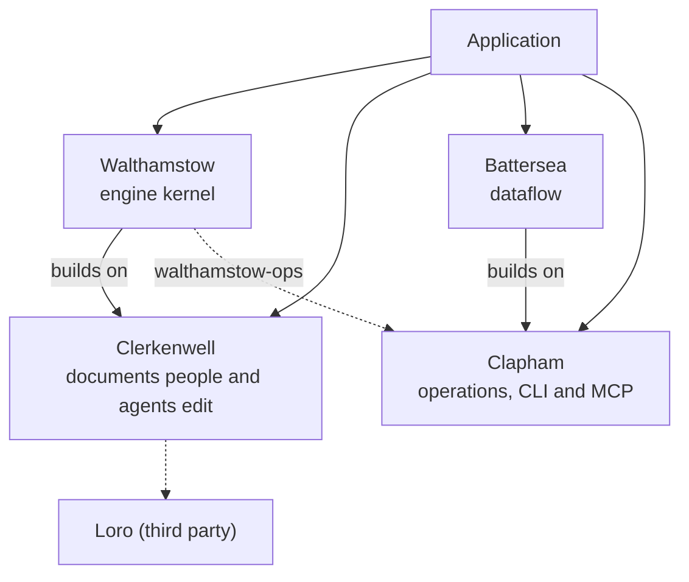

# Overview

The London Project is an experimental set of modular technologies for assembling agentic and
agent-enabled applications. An application takes the pieces it needs; none of them is an
application.

- **Agentic** applications are driven by agents: a flow of model calls and tools does the work,
  and people steer it.
- **Agent-enabled** applications are driven by people: an agent is a collaborator that reads
  and edits the same documents they do.

Both share one problem: an agent writes into state people care about. It works from stale
reads, retries, races people, and must not decide some things. The London Project treats the
agent as a second writer the system can refuse safely, not as a trusted one.

## Layers

Clerkenwell decides what a writer may change. Walthamstow keeps the documents and runs the
daemon. Battersea decides what the agent does next. Clapham describes each operation once and
presents the composed set as a CLI and an MCP server. Walthamstow builds on Clerkenwell, and
Battersea on Clapham. Walthamstow contributes its operations through the optional
`walthamstow-ops`, which builds on Clapham. The application joins all four.

## Principles

- **Modular.** Each piece is useful alone and released alone. Clerkenwell and Clapham depend
  on nothing else in the set.
- **The application owns its product.** Prompts, its own operations, assets, entities and validators
  belong to the application, which registers them into the pieces.
- **Refusals are named.** Every refusal carries a stable code a client can act on.
- **Explicit, not inferred.** Conflict policy is declared per field; document upgrades run only
  when invoked; durable execution resumes only when told to.
- **Released, not vendored.** Consumers take a tagged GitHub release of each piece.
- **Experimental.** Every piece is pre-1.0. Interfaces change between minor releases, and each
  changelog says how.
